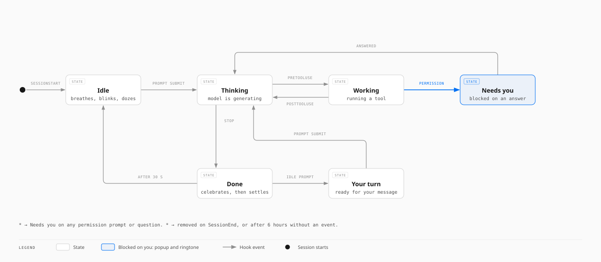
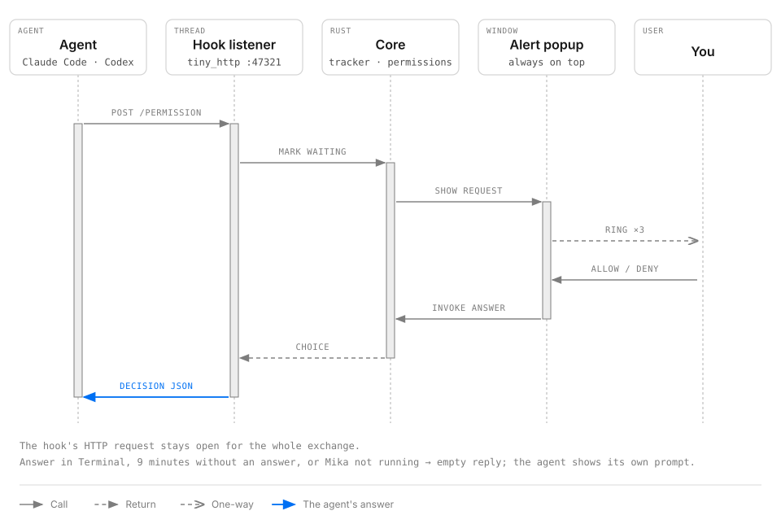

# Mika

**An observability and control layer for local AI coding agents, on macOS.**

Mika is a macOS menu bar application that observes Claude Code and Codex sessions running on the same machine. It reports the state of each session, token consumption, remaining plan limits and machine load. When a session is blocked on the user, Mika raises an always-on-top alert with a ringtone, accepts the answer to the permission request in place, and brings the session's terminal to the front.

The system has two parts. A Rust core, hosted by Tauri 2, is authoritative for data acquisition, session state and alert decisions. A React and TypeScript window is authoritative for presentation only.

**Contents:** [System overview](#system-overview) · [Capabilities](#capabilities) · [Installation and integration](#installation-and-integration) · [Architecture](#architecture) · [Runtime behaviour](#runtime-behaviour) · [Presentation layer](#presentation-layer) · [Interface reference](#interface-reference) · [Trust boundaries and privacy](#trust-boundaries-and-privacy) · [Development](#development) · [Known limitations](#known-limitations)

---

## System overview

Mika ingests four sources, processes them in the Rust core, and publishes the result to three surfaces: the main window, the menu bar title and the alert popup.

```
 SOURCES                      RUST CORE                        SURFACES
┌──────────────────────┐    ┌─────────────────────────┐     ┌──────────────────┐
│ Agent hooks          │───▶│ status.rs               │     │ Main window      │
│ curl → 127.0.0.1     │    │ permission.rs           │     │ (React)          │
├──────────────────────┤    ├─────────────────────────┤     ├──────────────────┤
│ Session logs         │───▶│ tokens.rs               │     │ Alert popup      │
│ ~/.claude · ~/.codex │    │                         │────▶│ (React, #alert)  │
├──────────────────────┤    ├─────────────────────────┤     ├──────────────────┤
│ macOS processes,     │───▶│ sampler.rs              │     │ Menu bar title   │
│ memory, sensors      │    │                         │     │ (tray)           │
├──────────────────────┤    ├─────────────────────────┤     └──────────────────┘
│ Anthropic usage      │───▶│ claude_limits.rs        │              │
│ endpoint (HTTPS)     │    │                         │◀─────────────┘
└──────────────────────┘    └─────────────────────────┘   commands (invoke)
                              managed state + events
```

Three properties follow from this arrangement.

- **Hooks are optional.** Token usage, sessions and machine health derive from the agents' logs and the process list, so they function without hooks. Hooks add live status, alerts and in-place answers.
- **The core owns decisions.** Alert policy runs in Rust, so it continues while the window is hidden.
- **The window holds no authoritative state.** It requests the latest stored values on open and then follows events.

---

## Capabilities

| Area | Capability |
| --- | --- |
| **Live status** | The state of each session (thinking, working, needs you, your turn, done, idle), rendered by the Mika character, in the header and in the menu bar title. |
| **Alerts** | An always-on-top popup with a ringtone when a session is blocked on the user, on the display in use. Optional alerts on completion. Quiet hours. |
| **Answer from Mika** | A permission request is approved or denied from the popup: Allow, Always allow (Claude Code only), Deny, or returned to the terminal. |
| **Session focus** | One action brings the correct Terminal or iTerm2 tab to the front, or otherwise the application hosting the agent. |
| **Token usage** | A live counter for today, this month or all time, with estimated cost, tokens per second and a per-model breakdown. |
| **Activity** | A year heatmap and an 88-day trend line, with a per-day readout on hover. |
| **Plan limits** | The remaining share of Claude and Codex limits, and the reset time of each. |
| **Sessions** | Title, model, effort, subagents, calls, cache hit rate, tokens, cost, context fill and prompt-cache expiry per session. |
| **Machine health** | Central processing unit (CPU) load, memory and temperature for the machine, plus CPU and memory for every agent and each process it started. |
| **Settings** | Sounds, popup behaviour, default range, cost estimates, motion level, menu bar title style, the Liquid Glass skin, tracked agents, update interval, hooks and launch at login. |

### Agent compatibility

| | Live status | Answer from Mika | Tokens and cost | Plan limits | Resources |
| --- | --- | --- | --- | --- | --- |
| **Claude Code** | thinking, tools, needs you, your turn, done | Allow, Always allow, Deny | yes | yes | yes |
| **Codex** (command-line interface and ChatGPT app) | working, needs you, done | Allow, Deny | yes | yes | yes |

The supported platform is macOS only, for now.

---

## Installation and integration

1. Install and open Mika. It appears in the menu bar.
2. **To enable live status and alerts**, open Settings → Integrations and select **Install** for Claude Code and for Codex. Sessions started afterwards report to Mika. Codex asks once for the new hooks to be trusted; approve them in Codex.
3. On the first display of Claude limits, macOS requests access to Claude Code's sign-in. Grant it to see the limits.

Manual integration is equivalent: merge [`hooks/claude-code-settings.json`](hooks/claude-code-settings.json) into `~/.claude/settings.json` and [`hooks/codex-hooks.json`](hooks/codex-hooks.json) into `~/.codex/hooks.json`.

---

## Architecture

### Components and responsibilities

Each source has one Rust module that is authoritative for reading it.


| Source | Module | Acquisition | Authoritative for |
| --- | --- | --- | --- |
| Agent hooks (Claude Code, Codex) | `status.rs`, `permission.rs` | Each hook runs `curl` and posts its JavaScript Object Notation (JSON) payload to `127.0.0.1:47321` | Session state; pending permission requests |
| Session logs in `~/.claude/projects` and `~/.codex/sessions` | `tokens.rs` | File-change events, followed by an incremental parse of the new lines only | Daily and per-model usage, sessions, cost, tokens per second, Codex limits |
| macOS process list, memory and sensors | `sampler.rs` | `sysinfo`, once per second by default | Agents, their process trees, machine load, temperature, thermal pressure |
| Anthropic's usage endpoint | `claude_limits.rs` | Claude Code's sign-in read from the Keychain, then one HTTPS request every 5 minutes | Claude plan name and limit windows |

### Concurrency model

Four background threads keep shared state current. Each thread stores its latest result in Tauri-managed state and emits it to the window as an event. The window requests the stored copy when it opens. This removes the wait for the next tick before the first render.


| Thread | Entry point | Cadence | Event | Managed state |
| --- | --- | --- | --- | --- |
| Hook listener | `spawn_hook_listener` | On each hook post | `statuses` | `Statuses` (the session tracker) |
| Token scanner | `spawn_token_scanner` | On file changes, in bursts of 80–300 ms; one tick per second; a full rescan every 30 s | `tokens` | `LatestTokens` |
| Sampler | `spawn_sampler` | Every 1 s (configurable, 0.5–10 s) | `agents`, and `statuses` again | `Latest` |
| Limits poller | `spawn_claude_limits` | Every 5 min; 15 min after a failure | `claude_limits` | `LatestClaudeLimits` |

Two further state objects serve alerts: `AlertState` holds what the popup is showing, and `Permissions` holds the requests awaiting an answer. User settings reside in `AppSettings`, persisted to a JSON file.

### Design decisions

| Decision | Rationale |
| --- | --- |
| Alerts are raised by the Rust core, not by the window. | macOS suspends the page of a hidden window. An alert raised by the page would not fire while Mika is in the menu bar. |
| Logs are parsed incrementally. | The agents' logs are large and append-only. Each file retains a read offset and a small parse state, so a scan parses only the lines added since the previous scan. |
| Both windows load one bundle. | The alert popup loads the same build at `index.html#alert` and renders `AlertPopup` in place of `App`. One build serves both surfaces. |
| The application is menu bar only. | Mika runs with the Accessory activation policy and `LSUIElement`, so it has no Dock icon. Closing or minimising the window hides it. Cmd+Q is replaced by "Hide to Menu Bar". |

---

## Runtime behaviour

### Startup sequence

1. Tauri builds the application, registers the managed state and the commands, and creates the tray icon with its menu (Show Mika, About, Quit).
2. Settings are loaded from `settings.json` in the application configuration folder. Every field has a default, so older or partial files still load.
3. The main window starts invisible. It is shown unless Mika was started by the login item, which passes `--hidden`.
4. The four threads start. The token scanner performs one full scan of the logs, then switches to watching for changes.
5. The window calls `latest_snapshot`, `session_statuses`, `latest_tokens` and `claude_limits` for the current data, then subscribes to the events.

### Session state machine

Each hook event moves a session between states. The tracker holds one entry per session identifier. The menu bar title and the header show the most urgent session.



| Hook event | Resulting state |
| --- | --- |
| `SessionStart` | Idle |
| `UserPromptSubmit`, `PostToolUse`, `PostToolUseFailure` | Thinking |
| `PreToolUse` | Working, with the tool's name |
| `PermissionRequest` | Needs you |
| `Notification` of type `permission_prompt`, `elicitation_dialog`, `elicitation_url_dialog` or `agent_needs_input` | Needs you |
| `Notification` of type `idle_prompt` | Your turn |
| `Stop` | Done, which settles to Idle after 30 s |
| `SessionEnd` | The session is removed |

Urgency is ordered Idle < Done < Thinking < Working < Your turn < Needs you. A session with no event for 6 hours is dropped. This covers agents that crashed or were killed.

Sessions without hooks still show activity. The window marks an agent as working when it averages 5% CPU or more over its last three samples.

### Alert policy

On each state change, `alert_on_change` selects the response.

| Transition | Response |
| --- | --- |
| → Needs you | The popup appears with a ringtone (three rings, two seconds apart) and remains until the user acts. |
| → Needs you, while the popup awaits an answer for another session | A chime and a notification. The first request is never covered. |
| → Your turn | Nothing is blocked, so at most one chime. The default is no sound. |
| → Done | A popup that clears itself after 12 s, where "alert when finished" is enabled. |

All sounds are subject to the sound setting and to quiet hours.

### Permission request protocol

Permission requests are handled synchronously. Mika's `PermissionRequest` hook posts the request and waits. Mika holds that Hypertext Transfer Protocol (HTTP) request open until the user chooses.



- **Allow** and **Deny** answer the hook with the agent's decision JSON. The agent proceeds without showing its own prompt.
- **Always allow** additionally saves a permission rule. Only Claude Code accepts such a rule, so Codex is never offered it. It is also never offered for commands the popup flags as risky, for example `sudo` or piping a download into a shell.
- **In Terminal**, no answer within 9 minutes, and Mika not running all produce an empty answer. The agent then falls back to its normal prompt.
- The hook's own timeout is longer than Mika's. The fallback is therefore always a clean empty reply, never a failed hook.
- Requests are queued and shown one at a time. Each waits on its own thread, so other hooks continue to flow.
- The buttons ignore clicks for a moment after a new request appears. A click intended for another window cannot approve a request the user has not read.

With "answer from Mika" disabled, the listener replies with an empty `204` at once, and the popup only identifies the waiting session.

### Session focus

`focus_agent` resolves the agent's controlling terminal with `ps`, then uses AppleScript to select the Terminal or iTerm2 tab attached to that terminal. Where that is not possible, it brings the hosting application to the front. Mika only opens an `.app` bundle that exists, never an arbitrary path. Some hosts run agents in a background helper; these are mapped to the application that owns the window.

### Token pipeline

1. `notify` watches `~/.claude/projects`, `~/.codex/sessions` and `~/.codex/session_index.jsonl` through FSEvents, the macOS file-system events interface.
2. Agents write in bursts. Changes are gathered for up to 300 ms, ending early after an 80 ms quiet gap, and are read in one pass.
3. Each changed file is read from its last offset. Claude lines carry usage per assistant message. Codex lines carry running totals, so Mika takes the difference from the previous total.
4. Usage is aggregated per day and model, and per session. Session lists are built for today, this month and all time, so a range switch in the window needs no recomputation.
5. Cost is estimated from public list prices per million tokens (input, output, cache read, cache write). Unknown models fall back to the price of their family.
6. Statistics are published at least once per second. Tokens per second, measured over a 60-second window, therefore decays to zero when the agents stop.

Codex limits are read from the same logs. Codex's automatic review runs are counted per model and day, and are presented as one summary row, not as sessions.

### Resource sampling

The sampler walks the process list and recognises agents by executable name. Claude Code installed through npm is recognised by its script path. Every descendant process is attached as a tree. Codex processes that share a parent are merged into one agent, because the ChatGPT app runs Codex as sibling processes. Each agent also records the application hosting it, which is the target of session focus.

Temperature is taken from the hottest CPU die sensor on Apple Silicon, or from the System Management Controller (SMC) CPU sensors on Intel. Thermal pressure is read from `NSProcessInfo`.

---

## Presentation layer

The window is React 19 with TypeScript, built by Vite.

| File | Responsibility |
| --- | --- |
| `App.tsx` | The main window: header, range picker, the Overview, Agents and Settings pages, and the tab bar. Subscribes to the events. |
| `Usage.tsx` | Totals, limits, models, sessions, the system panel, and the Activity heatmap and trend. |
| `Mika.tsx` | The character. Each state has a library of short clips, played in random order with a rest between them. |
| `AlertPopup.tsx` | The popup window: needs you, finished, or a permission request to answer. |
| `SettingsPage.tsx`, `settings.tsx` | The settings page, and a provider that keeps settings synchronised across both windows. |
| `motion.ts` | All motion. GSAP drives rolling numbers, the sliding pill, the staggered entrance, pops and shakes. anime.js drives the heatmap ripple, the trend draw-in and the hover spring. |
| `liquid.ts` | The Liquid Glass skin, drawn with WebGPU behind the Document Object Model (DOM). |
| `scrollbars.ts` | Thin scrollbars that are shown only while the mouse is active over Mika. |

- **Layout.** Narrow windows show one page at a time. From a width of 760px, Overview and Agents are placed side by side.
- **Motion.** Three levels exist: full, subtle and off. Off is forced when macOS "Reduce motion" is enabled. Entrances and chart animations run at full only.
- **Skins.** Classic renders flat cards with hairline borders. Liquid Glass paints a soft wallpaper and a refracting glass shape under each card and control. It exposes controls for transparency, frost, refraction, shine and shadow, and four backdrops.
- **Menu bar title.** Full (state, agent count, and the agents' CPU and memory), compact (symbol and count) or icon only.

---

## Interface reference

### Events (core → window)

| Event | Payload | Emitted |
| --- | --- | --- |
| `agents` | `Snapshot`: machine load and every agent with its process tree | On each sample |
| `statuses` | `SessionStatus[]` | On each hook event and each sample |
| `tokens` | `TokenStats`: days, sessions per range, reviews, Codex limit, tokens per second | On each change, and at least once per second |
| `claude_limits` | `ClaudeLimits`: plan and limit windows | On each successful poll |
| `settings` | `Settings` | When settings are saved |
| `alert` | `AlertInfo`, to the popup window only | When the popup is shown or updated |

### Commands (window → core)

| Group | Commands |
| --- | --- |
| Latest data | `latest_snapshot`, `session_statuses`, `latest_tokens`, `claude_limits` |
| Settings | `get_settings`, `set_settings`, `preview_sound` |
| Hooks | `hooks_status`, `install_hooks`, `remove_hooks` |
| Alerts | `show_alert`, `current_alert`, `dismiss_alert`, `open_alert_target`, `answer_permission`, `alert`, `focus_app` |
| Diagnostics | `log_frontend` |

### Hook endpoints

The listener is `tiny_http`, bound to `127.0.0.1:47321`. It accepts bodies of up to 1 MB.

| Path | Caller | Behaviour |
| --- | --- | --- |
| `/hook` | Claude Code status hooks | Fire and forget. The hook's `curl` abandons the request after 1 s, so a stopped Mika does not delay an agent. |
| `/hook/codex` | Codex status hooks | As above, tagged as Codex. |
| `/permission` | Claude Code `PermissionRequest` | Held open until answered. The hook waits up to 590 s. |
| `/permission/codex` | Codex `PermissionRequest` | As above, tagged as Codex. |

### File system and credential access

| Path | Access | Purpose |
| --- | --- | --- |
| `~/.claude/projects/**/*.jsonl` | Read | Claude Code token usage and sessions |
| `~/.codex/sessions/**/*.jsonl`, `~/.codex/session_index.jsonl` | Read | Codex token usage, session titles and limits |
| `~/.claude/settings.json`, `~/.codex/hooks.json` | Read and write, only from Settings → Integrations | Installing or removing hooks. The current file is first backed up as `<name>.bak-mika-<timestamp>`. Only Mika's own entries are added or removed. |
| `settings.json` in the application configuration folder | Read and write | User settings |
| Keychain item `Claude Code-credentials` | Read | Claude plan limits. This access can be disabled. |

---

## Trust boundaries and privacy

Mika runs entirely on the user's machine. It reads the agents' local logs and the process list. It does not upload code, prompts or usage data.

- **One outbound request.** The only network call retrieves the Claude plan limits from `api.anthropic.com`, using the sign-in that Claude Code already keeps in the Keychain. The token is held in memory for that request only and is never logged. With "Claude limits" disabled in Settings, Mika accesses neither the Keychain nor the network.
- **Loopback listener only.** The hook listener binds to `127.0.0.1`. It is not reachable from outside the machine.
- **Apple Events.** Mika requests automation permission in order to select the terminal tab of the agent that needs the user. Without it, Mika brings the application to the front instead.
- **Hook ownership stays with the user.** Installation and removal are each a single action. Mika backs up the existing file first and leaves the user's own hooks untouched.

---

## Development

```bash
npm install
npm run tauri dev
```

This starts Vite on port 1420 and the Rust application, with hot reload for the window. Development builds optimise dependencies fully and Mika's own code lightly. An unoptimised build takes about 30 s to parse the logs at startup.

| Task | Command |
| --- | --- |
| Run the Rust tests | `cd src-tauri && cargo test` |
| Type-check and build the window | `npm run build` |
| Build a universal application and disk image | `npm run release:mac` |

`release:mac` builds for Apple Silicon and Intel. The outcome depends on the signing material available.

| Condition | Result |
| --- | --- |
| A "Developer ID Application" certificate in the keychain, and `APPLE_ID`, `APPLE_PASSWORD` and `APPLE_TEAM_ID` set in the environment or in `.env.release.local` | The application is signed, notarised and stapled. |
| Otherwise | The application is ad-hoc signed. Other machines open it only through System Settings → Privacy & Security → Open Anyway. |

### Repository layout

```
src/                  React window (see "Presentation layer")
src-tauri/src/
  lib.rs              Application setup, tray, threads, commands, alert policy
  status.rs           Hook listener and the session state machine
  permission.rs       Pending permission requests and decision JSON
  alert.rs            The popup window, ringtone and session focus
  tokens.rs           Incremental log parsing, usage, cost, Codex limits
  sampler.rs          Processes, agents, machine load, temperature
  claude_limits.rs    Claude plan limits
  settings.rs         Settings file and the hooks installer
hooks/                Hook templates for Claude Code and Codex
docs/architecture/    The diagrams on this page, as SVG and HTML
scripts/              release-macos.sh
```

### Technology stack

| Layer | Libraries |
| --- | --- |
| Shell | Tauri 2 (tray icon, autostart and opener plugins) |
| Core | Rust 2024, `sysinfo`, `tiny_http`, `notify`, `ureq`, `serde`, `chrono`, `objc2-foundation` |
| Window | React 19, TypeScript, Vite, GSAP, anime.js, `@liquid-dom/core` (WebGPU), Geist |

---

## Known limitations

- Costs are estimates derived from public API prices. They are not the actual bill.
- Claude Code does not record its context size. The context bar therefore appears for Codex sessions only.
- Session focus selects the exact tab in Terminal and iTerm2. In other applications it brings the application to the front, but cannot select a tab or thread within it.
- Claude limits are read from a service that Anthropic has not documented publicly. It may change.
- Codex asks once for newly installed hooks to be trusted.

---

## Licence

MIT. See [LICENSE](LICENSE).
