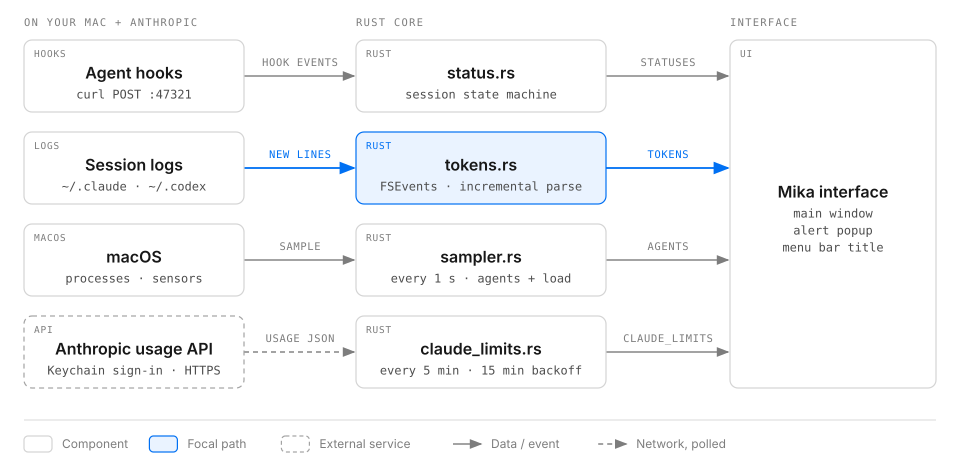

# Mika

**Your AI coding agents, at a glance.**

Mika is a small companion that lives in your Mac's menu bar and keeps an eye on Claude Code and Codex for you. It shows what every agent is doing, how many tokens they're using, how close you are to your plan limits, and how hard your Mac is working. When an agent needs you, Mika pops up on your desktop with a ringtone and takes you straight to it.

---

## Why Mika

Running several AI agents at once is powerful, and hard to keep track of. You start a task in Claude Code, another in Codex, switch to something else, and then:

- an agent has been waiting for your approval for ten minutes,
- you've burned through most of your weekly limit without noticing,
- your fans spin up and you're not sure which agent is to blame.

Mika answers all three without you switching windows.

---

## Meet Mika

Mika is a little ghost that shows the mood of your agents at a glance.

- **Thinking:** gazes off with thought bubbles, tilts its head, scans around.
- **Working:** hops, types away, spins, dashes about.
- **Needs you:** turns red, waves an "!", pings like radar, knocks to get your attention.
- **Done:** celebrates with a burst of sparkles.
- **Idle:** breathes slowly, blinks, dozes off.

Each mood has its own set of animations, played in a different order every time, so Mika always feels alive.

---

## Never miss a "needs you" moment

When Claude Code or Codex stops to ask a question or needs your approval, Mika:

- pops up a small card on the screen you're using, showing which agent is waiting, what it wants to do, and for how long,
- 🔔 rings your chosen sound three times,
- turns its status red and shows *which* project is waiting.

The card stays until you act on it. Click **Open** (or press Enter) to jump to the app running that session, or **Dismiss** (Escape) to close it. Clicking the red "Needs you" header in Mika also takes you there.

---

## Know exactly where your tokens go

- **Today, this month, or all time:** one tap switches the view.
- **A live token counter** that rolls up as your agents work, with an estimated cost.
- **Tokens per second**, so you can feel how busy things are.
- **Per-model breakdown:** see how much went to Opus, GPT, Haiku and the rest.
- **Activity heatmap and trend:** spot your busiest days and spikes at a glance.

Mika reads usage straight from your agents' own logs and updates within about half a second.

---

## Stay ahead of your plan limits

See how much of your **Claude** and **Codex** plans you have left, and exactly when each limit resets, side by side. No more surprises halfway through a big task.

---

## Every session, in detail

Each session shows its title, model, effort level, subagents, number of calls, cache hit rate, token count and estimated cost, plus how full its context is and how long its prompt cache will last. Sessions that are live right now show a tiny animated Mika. Long lists are split into pages that fit your window.

---

## Your Mac's health, too

Live **CPU**, **memory**, **swap** and **temperature** for the whole machine, plus CPU and memory for each running agent and every process it started. When your Mac slows down, you'll see why.

---

## Make it yours

Open **Settings** from the gear in the top-right corner:

- **Alerts:** sound on or off and which sound, the popup, alerts when an agent finishes, and quiet hours.
- **Display:** default range, cost estimates, animation level (full, subtle, off) and the menu bar title style.
- **Data & privacy:** choose which agents to track, turn Claude limits (and its Keychain and network access) off, and pick an update speed.
- **Integrations:** install or remove Claude Code and Codex hooks with one click. Your existing file is backed up first.
- **General:** launch at login.

Changes apply immediately.

---

## Designed to stay out of the way

- Lives in the menu bar. Click to open, click to hide.
- A clean, light look with smooth, subtle motion and glass controls.
- Opens tall and narrow, and adapts to any window size.
- Respects macOS "Reduce motion".

---

## Private by design

Mika runs entirely on your Mac. It reads your agents' local logs and process list, and never uploads your code, prompts or usage anywhere. The only thing it asks the internet for is your Claude plan limits, using the same sign-in Claude Code already uses.

---

## Works with

| | Live status | Tokens and cost | Plan limits | Resources |
| --- | --- | --- | --- | --- |
| **Claude Code** | ✓ thinking, tools, needs you, done | ✓ | ✓ | ✓ |
| **Codex** (CLI and ChatGPT app) | ✓ working, needs you, done | ✓ | ✓ | ✓ |

macOS only, for now.

---

## Getting started

1. Install and open Mika. It appears in your menu bar.
2. **For live status and alerts**, open Settings → Integrations and click **Install** for Claude Code and Codex. New sessions will then report to Mika. Codex asks you once to trust the new hooks; approve them in Codex. (To do it by hand, merge [`hooks/claude-code-settings.json`](hooks/claude-code-settings.json) into `~/.claude/settings.json` and [`hooks/codex-hooks.json`](hooks/codex-hooks.json) into `~/.codex/hooks.json`.)
3. The first time Mika shows your Claude limits, macOS asks to allow access to Claude Code's sign-in. Allow it to see them.

That's it. Start an agent and watch Mika come to life.

---

## Good to know

- Costs are estimates based on public API prices, not your actual bill.
- Claude Code doesn't record its context size, so the context bar appears for Codex sessions only.
- "Open" brings the right app to the front, but can't pick a specific tab or thread inside it.
- Claude limits come from a service Anthropic hasn't documented publicly and may change.

---

## How it works

Mika gathers from four sources on your Mac, processes them in a small Rust core, and shows the result in its window, menu bar title and alerts.



Inside the core, four background threads keep shared state up to date, Tauri sends it to the window, and the window calls back into Rust to sound alerts.



Interactive versions: [overview](docs/architecture/overview.html) · [Rust core](docs/architecture/rust-core.html).

---

## For developers

Mika is built with Tauri 2 (Rust) and React + TypeScript.

```bash
npm install
npm run tauri dev
```

Run the tests with `cd src-tauri && cargo test`.
